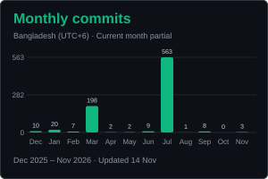
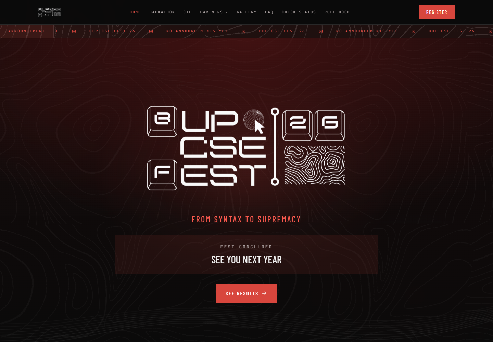
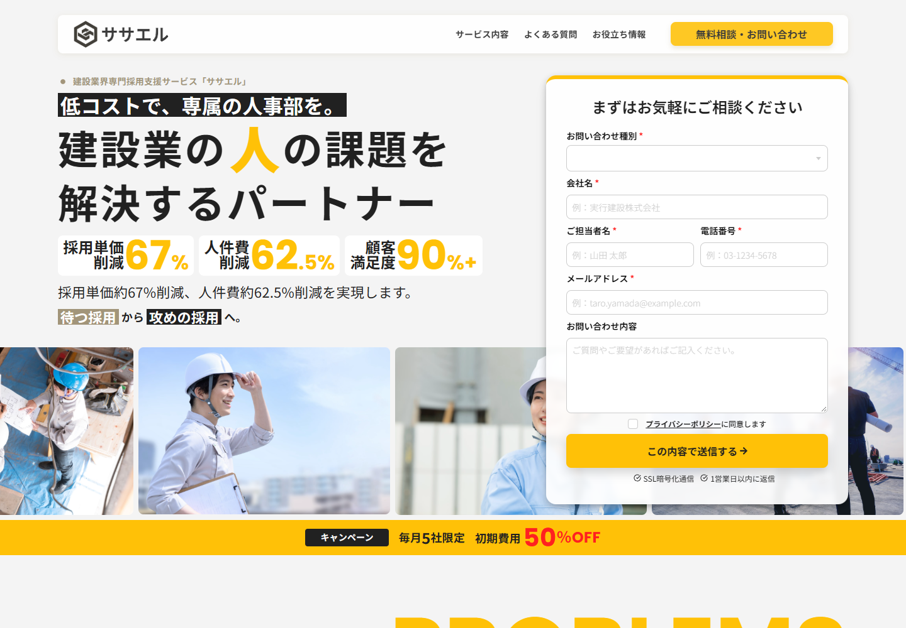
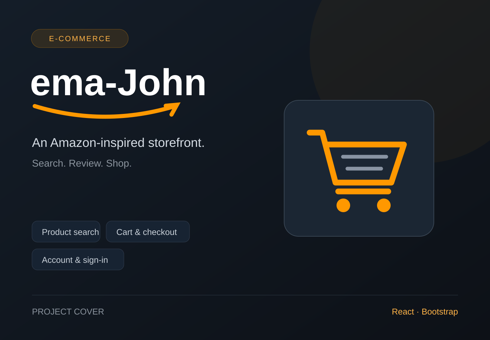

 

<table width="100%">
  <tr>
    <td width="33%"><a href="https://www.linkedin.com/in/akmtasdikulislam">&nbsp;LinkedIn</a></td>
    <td width="33%"><a href="https://akmtasdikulislam.dev">&nbsp;akmtasdikulislam.dev</a></td>
    <td width="33%"><a href="https://www.upwork.com/freelancers/~01fe1fc80c8877ffe2">&nbsp;Upwork</a></td>
  </tr>
  <tr>
    <td width="33%"><a href="mailto:akmtasdikulislam@gmail.com">&nbsp;akmtasdikulislam@gmail.com</a></td>
    <td width="33%"><a href="https://x.com/Akm_Tasdikul">&nbsp;@Akm_Tasdikul</a></td>
    <td width="33%"><a href="https://github.com/akmtasdikulislam">&nbsp;GitHub</a></td>
  </tr>
</table>

 

  
  
  

---

 

Full Stack Web Developer and Computer Science student at **Bangladesh University of Professionals** with **2+ years** of hands-on MERN stack experience building production-ready web applications. Strong in clean architecture, scalable code, and delivering high-quality SaaS-ready solutions.

Experienced with AI-assisted development tools like **Cursor**, **GitHub Copilot**, and **Windsurf** while applying solid manual debugging to ensure code reliability. Expert in **n8n** — building complex AI agentic workflows, chatbot systems, and multi-platform integrations from scratch.

---

 

| **Full-Stack Web Applications** — End-to-end MERN stack apps from schema design to React UI, with RESTful APIs, JWT auth, and cloud deployment. | **AI Agentic Workflows** — n8n automation pipelines integrating LLMs, webhooks, APIs, and databases to automate business processes end-to-end. |
| ------------------------------------------------------------------------------------------------------------------------------------------------- | ---------------------------------------------------------------------------------------------------------------------------------------------- |
| **Modern UI Interfaces** — Pixel-perfect, responsive UIs with Next.js, Tailwind CSS, GSAP, and Three.js — every interaction built with intention. | **AI Chatbots & Agents** — Custom AI agents on web platforms using OpenAI/Claude APIs, RAG pipelines, and MCP server integrations.             |

 

### Programming Languages

<table width="100%">
  <tr>
    <td align="center" width="110">
       <b>C</b>
    </td>
    <td align="center" width="110">
       <b>C++</b>
    </td>
    <td align="center" width="110">
       <b>Java</b>
    </td>
    <td align="center" width="110">
       <b>Python</b>
    </td>
    <td align="center" width="110">
       <b>JavaScript</b>
    </td>
    <td align="center" width="110">
       <b>TypeScript</b>
    </td>
    <td align="center" width="110">
       <b>PHP</b>
    </td>
    <td align="center" width="110">
       <b>HTML5</b>
    </td>
    <td align="center" width="110">
       <b>CSS3</b>
    </td>
  </tr>
</table>

 

<table width="100%">
<tr>

<td valign="top" width="50%">

###  Frontend

<table width="100%">
  <tr>
    <td align="center" width="100">
       React
    </td>
    <td align="center" width="100">
       Next.js
    </td>
    <td align="center" width="100">
       Tailwind CSS
    </td>
    <td align="center" width="100">
       Bootstrap
    </td>
  </tr>
  <tr>
    <td align="center" width="100">
       Sass
    </td>
    <td align="center" width="100">
       React Native
    </td>
    <td align="center" width="100">
       WordPress
    </td>
    <td align="center" width="100">
       Wix
    </td>
  </tr>
</table>

</td>

<td valign="top" width="50%">

###  Frameworks & Integrations

<table width="100%">
  <tr>
    <td align="center" width="100">
       Material UI
    </td>
    <td align="center" width="100">
       Shadcn UI
    </td>
    <td align="center" width="100">
       DaisyUI
    </td>
    <td align="center" width="100">
       Three.js
    </td>
  </tr>
  <tr>
    <td align="center" width="100">
       GSAP
    </td>
    <td align="center" width="100">
       Framer Motion
    </td>
    <td align="center" width="100">
       Mapbox
    </td>
    <td align="center" width="100">
       Stripe
    </td>
  </tr>
</table>

</td>
</tr>

<tr>

<td valign="top" width="50%">

###  Backend & Database

<table width="100%">
  <tr>
    <td align="center" width="100">
       Node.js
    </td>
    <td align="center" width="100">
       Express.js
    </td>
    <td align="center" width="100">
       Django
    </td>
    <td align="center" width="100">
       MongoDB
    </td>
  </tr>
  <tr>
    <td align="center" width="100">
       PostgreSQL
    </td>
    <td align="center" width="100">
       MySQL
    </td>
    <td align="center" width="100">
       Firebase
    </td>
    <td align="center" width="100">
       Supabase
    </td>
  </tr>
  <tr>
    <td align="center" width="100">
       Redis
    </td>
    <td align="center" width="100">
       Cloudinary
    </td>
    <td align="center" width="100">
       OpenAI
    </td>
    <td align="center" width="100">
       Claude AI
    </td>
  </tr>
</table>

</td>

<td valign="top" width="50%">

###  Tools & Platforms

<table width="100%">
  <tr>
    <td align="center" width="100">
       Git
    </td>
    <td align="center" width="100">
       Docker
    </td>
    <td align="center" width="100">
       Figma
    </td>
    <td align="center" width="100">
       n8n
    </td>
  </tr>
  <tr>
    <td align="center" width="100">
       WordPress
    </td>
    <td align="center" width="100">
       Arduino
    </td>
    <td align="center" width="100">
       Photoshop
    </td>
    <td align="center" width="100">
       Illustrator
    </td>
  </tr>
  <tr>
    <td align="center" width="100">
       VS Code
    </td>
    <td align="center" width="100">
       Postman
    </td>
    <td align="center" width="100">
       Cursor
    </td>
    <td align="center" width="100">
       AutoCAD
    </td>
  </tr>
</table>

</td>
</tr>
</table>

---

 

<table>
  <tr>
    <td width="50%" align="center"></td>
    <td width="50%" align="center"></td>
  </tr>
</table>

---

 

<table width="100%">
  <tr>
    <td width="42%" align="center" valign="middle">
      
    </td>
    <td width="58%" valign="top">
      <h3><a href="https://fest.akmtasdikulislam.dev">BUP CSE Fest 2026</a></h3>
      
<strong>University tech fest &amp; competition portal</strong>

      
Event website for the BUP Computer Programming Club, bringing hackathon, CTF, programming, and gaming competitions together in one place.

      
Competition details, team registration and status pages, event timelines, sponsor showcases, a photo gallery, and certificate verification.

      
  

      
<a href="https://fest.akmtasdikulislam.dev"><strong>Visit website</strong></a>

    </td>
  </tr>
  <tr>
    <td width="42%" align="center" valign="middle">
      
    </td>
    <td width="58%" valign="top">
      <h3><a href="https://media.kensetsu-hr.com">Sasaeru</a></h3>
      
<strong>Recruitment support for Japan’s construction industry</strong>

      
Japanese business website presenting recruitment outsourcing and hiring support for construction companies.

      
Service and pricing information, client case studies, recruitment articles, FAQs, and consultation forms help visitors explore the service and make an inquiry.

      
  

      
<a href="https://media.kensetsu-hr.com"><strong>Visit website</strong></a>

    </td>
  </tr>
  <tr>
    <td width="42%" align="center" valign="middle">
      
    </td>
    <td width="58%" valign="top">
      <h3><a href="https://ema-john-8l3n.onrender.com">Ema John</a></h3>
      
<strong>Amazon-inspired e-commerce application</strong>

      
React storefront with product search, a cart summary, and order-review and inventory sections.

      
A checkout entry point and account screens for email/password and Google sign-in support the shopping experience.

      
   

      
<a href="https://ema-john-8l3n.onrender.com"><strong>Visit website</strong></a>

    </td>
  </tr>
</table>

---

 

<table width="100%">
<tr>
  <td width="25%"><a href="https://codeforces.com/profile/akmtasdikulislam">&nbsp; <strong>Codeforces</strong></a></td>
  <td width="25%"><a href="https://leetcode.com/u/akmtasdikulislam/">&nbsp; <strong>LeetCode</strong></a></td>
  <td width="25%"><a href="https://www.hackerrank.com/profile/akmtasdikulislam">&nbsp; <strong>HackerRank</strong></a></td>
  <td width="25%"><a href="https://www.codechef.com/users/akmtasdikul">&nbsp; <strong>CodeChef</strong></a></td>
</tr>
</table>

Actively participating in competitive programming contests and CTF challenges — **Data Structures**, **Algorithms**, **Dynamic Programming**, and **Problem Solving** in C, C++, and Python.

---

 

| Course                         | Provider                     | Year           |
| ------------------------------ | ---------------------------- | -------------- |
| CSE Fundamentals — Fall 2025   | Phitron                      | 2025 – Present |
| Technical Support Fundamentals | Google / Coursera            | 2022           |
| Photography Basics             | Robi 10 Minute School        | 2022           |
| Digital Security Essentials    | Digital Security Agency, a2i | 2020           |

---

 

<table width="100%">
  <tr>
    <td width="50%" valign="top">
      &nbsp; <strong>Founder &amp; President — Iconic IT Club, BAFSK</strong> &nbsp;<em>2021–22</em> 
      Founded and led the campus IT club. Engaged <strong>600+ students</strong> in ICTOB Season 1. Awarded <strong>Best Campus Ambassador</strong>.
    </td>
    <td width="50%" valign="top">
      &nbsp; <strong>CADET Lance Corporal — BNCC</strong> &nbsp;<em>Jun 2022 – Jun 2024</em> 
      Completed 7-day Battalion Camp. Participated in Firing Competition with a <strong>4-inch grouping score</strong>.
    </td>
  </tr>
</table>

---

 

<table width="100%">
  <tr>
    <td width="33%" align="center">
       
      <strong>Bangla</strong> 
      Native
    </td>
    <td width="33%" align="center">
       
      <strong>English</strong> 
      Near-native
    </td>
    <td width="33%" align="center">
       
      <strong>German</strong> 
      Basic
    </td>
  </tr>
</table>

---

 

I'm always open to collaborating on interesting projects, open-source contributions, and freelance opportunities.

<table width="100%">
<tr>
  <td><a href="https://www.linkedin.com/in/akmtasdikulislam">&nbsp; LinkedIn</a></td>
  <td><a href="https://akmtasdikulislam.dev">&nbsp; akmtasdikulislam.dev</a></td>
  <td><a href="https://www.upwork.com/freelancers/~01fe1fc80c8877ffe2">&nbsp; Upwork</a></td>
  <td><a href="mailto:akmtasdikulislam@gmail.com">&nbsp; akmtasdikulislam@gmail.com</a></td>
  <td><a href="https://x.com/Akm_Tasdikul">&nbsp; @Akm_Tasdikul</a></td>
</tr>
</table>

 
